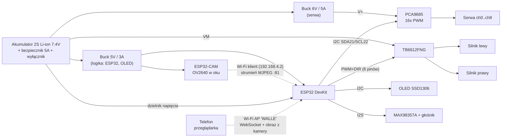

# Wall-E – elektronika i sterowanie z telefonu (ESP32)

> Status: **projekt / do potwierdzenia**. Elementy oznaczone ⚠️ to założenia – zweryfikuj
> je z faktycznie posiadanym sprzętem (typ silników, liczba serw) przed lutowaniem.

## 1. Założenia

| Element | Założenie | Uwagi |
|---|---|---|
| Mikrokontroler | ESP32 DevKit (38 pin, WROOM-32) | jedyny sterownik, brak Arduino |
| Napęd | 2 × silnik DC z przekładnią (gąsienice) ⚠️ | 6–12 V, prąd < 1 A na silnik |
| Sterownik silników | TB6612FNG (zamiennie L298N) | TB6612: 1,2 A ciągłe, mniejsze straty |
| Serwa | do 9 szt. ⚠️ (szyja ×2, głowa, ramiona ×2, oczy ×2, dłonie ×2 opcjonalnie) | 5–6 V, np. MG90S / SG90 |
| Sterownik serw | PCA9685 (I²C, 16 kanałów) | odciąża ESP32, zasilanie serw osobne |
| Wyświetlacz | OLED SSD1306 128×64 I²C (ramka `OLED_frame_v2`) | na tej samej magistrali I²C |
| Kamera | **ESP32-CAM (AI-Thinker, OV2640) jako osobny moduł** w głowie/oku | własny procesor, strumień MJPEG; nie zajmuje pinów głównego ESP32 |
| Dźwięk (opcja) | MAX98357A (I²S) + głośnik 3 W | |
| Zasilanie | akumulator 2S Li-ion 7,4 V (8,4 V naładowany) + przetwornice | |
| Łączność z telefonem | **Wi-Fi AP + WebSocket + strona WWW z ESP32** | bez instalowania aplikacji |

## 2. Schemat blokowy



## 3. Zasilanie

```
Akumulator 2S ──[bezpiecznik 5A]──[wyłącznik]──┬── Buck 5V  ──► ESP32 (VIN/5V), OLED (3V3 z ESP32), ESP32-CAM (5V)
                                               ├── Buck 6V  ──► PCA9685 V+ (zasilanie serw) + kondensator 1000 µF
                                               └── bezpośrednio ► TB6612 VM (silniki) + kondensator 470 µF
GND wszystkich modułów połączone w jednym punkcie (wspólna masa).
```

Zasady:
- Serw **nie** zasilamy z pinu 5V ESP32 – szarpnięcie serwa resetuje ESP32.
- Kondensator elektrolityczny 1000 µF przy złączu V+ PCA9685, 470 µF przy VM sterownika silników.
- Pomiar baterii: dzielnik 100 kΩ / 47 kΩ do GPIO34 (8,4 V → 2,69 V). Odcięcie programowe poniżej 6,6 V.
- ESP32-CAM pobiera ok. 180–300 mA (szczyty przy transmisji), dlatego przy jej złączu 5 V dajemy 470 µF; dioda flash (GPIO4 kamery) pozostaje wyłączona.
- Rezerwa prądowa: serwa w ruchu do ok. 2–3 A, dlatego osobny buck 6 V ≥ 5 A.

## 4. Mapa pinów ESP32

Unikamy pinów rozruchowych (0, 2, 12, 15), pamięci flash (6–11) i wejść-tylko (34–39) tam, gdzie potrzebne wyjście.

| GPIO | Funkcja | Podłączone do |
|---|---|---|
| 21 | I²C SDA | PCA9685 SDA, OLED SDA |
| 22 | I²C SCL | PCA9685 SCL, OLED SCL |
| 4 | Wyjście | PCA9685 `OE` (LOW = serwa aktywne, HIGH = wyłączone) |
| 25 | PWM | TB6612 `PWMA` (silnik lewy) |
| 26 | Wyjście | TB6612 `AIN1` |
| 27 | Wyjście | TB6612 `AIN2` |
| 32 | PWM | TB6612 `PWMB` (silnik prawy) |
| 33 | Wyjście | TB6612 `BIN1` |
| 14 | Wyjście | TB6612 `BIN2` |
| 13 | Wyjście | TB6612 `STBY` (HIGH = praca) |
| 18 | I²S BCLK | MAX98357A BCLK *(opcja)* |
| 19 | I²S LRC | MAX98357A LRC *(opcja)* |
| 23 | I²S DIN | MAX98357A DIN *(opcja)* |
| 34 | ADC (wejście) | dzielnik napięcia baterii |
| 3V3 | zasilanie | OLED VCC, PCA9685 VCC (logika), TB6612 VCC |

Adresy I²C: PCA9685 = `0x40`, OLED = `0x3C`.

## 5. Kanały serw (PCA9685) ⚠️

| Kanał | Funkcja | Zakres (°) | Pozycja startowa |
|---|---|---|---|
| 0 | Szyja dolna (pochylenie) | 60–120 | 90 |
| 1 | Szyja górna (pochylenie) | 60–120 | 90 |
| 2 | Obrót głowy | 40–140 | 90 |
| 3 | Ramię lewe | 0–120 | 0 |
| 4 | Ramię prawe | 0–120 | 0 |
| 5 | Oko lewe | 30–150 | 90 |
| 6 | Oko prawe | 30–150 | 90 |
| 7 | Dłoń lewa (opcja) | 0–90 | 45 |
| 8 | Dłoń prawa (opcja) | 0–90 | 45 |

Zakresy trzeba skalibrować mechanicznie na gotowym modelu (ograniczenia w firmware, żeby serwo nie dobijało do oporu).

## 6. Sterowanie z telefonu

1. ESP32 uruchamia sieć Wi-Fi (tryb AP): SSID `WALLE`, hasło ustawiane w firmware, adres `192.168.4.1`.
2. Telefon łączy się z tą siecią i otwiera w przeglądarce `http://192.168.4.1`.
3. ESP32 serwuje stronę z joystickiem (jazda), suwakami serw i przyciskami emocji.
4. Strona wysyła komendy przez WebSocket (`ws://192.168.4.1/ws`), ESP32 je interpretuje.

Alternatywa: BLE (np. aplikacja „Serial Bluetooth Terminal”) – ten sam protokół komend, inny transport.

### Kamera (ESP32-CAM)

Kamera działa jako osobny moduł i nie jest podłączona do głównego ESP32 żadnym przewodem sygnałowym – tylko zasilanie i masa.

- Główny ESP32 jest punktem dostępowym `WALLE`. ESP32-CAM łączy się z nim jako klient i dostaje **stały adres 192.168.4.2** (statyczny IP w firmware kamery).
- Kamera serwuje strumień MJPEG pod `http://192.168.4.2:81/stream` (przykład `CameraWebServer` z biblioteki ESP32).
- Strona sterowania na telefonie osadza obraz tagiem `` obok joysticka – jedno połączenie Wi-Fi, jedna strona.
- Ustawienia: rozdzielczość QVGA/VGA (320×240 – 640×480), jakość JPEG ok. 12 – kompromis między opóźnieniem a płynnością.
- Montaż: płytka ESP32-CAM jest duża, więc w głowie mieści się z reguły sam sensor OV2640 na dłuższej taśmie FFC (wersje z wymienną taśmą 15–30 cm), a płytka stoi w korpusie. Mocowanie w modelu: `eye-camera-mount` i `eye-camera-replica`.
- Programowanie ESP32-CAM wymaga adaptera USB-UART (płytka AI-Thinker nie ma portu USB) albo wersji z płytką bazową ESP32-CAM-MB.

### Protokół komend (JSON, jedna wiadomość = jedna komenda)

| Komenda | Przykład | Działanie |
|---|---|---|
| Jazda | `{"c":"drive","x":0.0,"y":0.8}` | joystick: y = przód/tył, x = skręt, zakres −1..1; mieszanie na lewy/prawy silnik |
| Serwo | `{"c":"servo","id":"armL","a":45}` | ustawia serwo (id lub numer kanału) na kąt w limitach |
| Poza | `{"c":"pose","n":"hello"}` | gotowa sekwencja serw (`home`, `hello`, `sad`, `curious`) |
| Ekran | `{"c":"oled","t":"EVE?"}` | tekst/animacja na OLED |
| Dźwięk | `{"c":"sound","n":"wall-e"}` | odtwarza zapisany dźwięk *(opcja)* |
| Kamera | `{"c":"cam","on":true}` | strona włącza/wyłącza podgląd (odpina ``, oszczędza pasmo) |
| Stop | `{"c":"stop"}` | natychmiast zatrzymuje silniki |
| Status | `{"c":"status"}` | odpowiedź: napięcie baterii, stan serw |

### Bezpieczeństwo

- **Fail-safe:** brak komendy `drive` przez 500 ms → silniki stop (utrata Wi-Fi, rozładowany telefon).
- Limity kątów serw wymuszane w firmware, nie tylko na stronie.
- Ograniczenie przyspieszenia silników (rampa), żeby nie szarpać przekładniami i nie obciążać baterii.
- Niskie napięcie baterii → stop silników, komunikat na OLED.

## 7. Lista zakupowa (BOM)

| Szt. | Element |
|---|---|
| 1 | ESP32 DevKit 38 pin |
| 1 | ESP32-CAM AI-Thinker + OV2640 (najlepiej z taśmą 15–30 cm) |
| 1 | Adapter USB-UART (lub ESP32-CAM-MB) do wgrania firmware kamery |
| 1 | TB6612FNG (moduł) |
| 1 | PCA9685 (moduł 16 kanałów) |
| 1 | OLED SSD1306 128×64 I²C |
| 9 | Serwa 9 g (MG90S) – liczba do potwierdzenia |
| 2 | Silniki DC z przekładnią (te, które już masz) |
| 1 | Akumulator 2S Li-ion + ładowarka/BMS 2S |
| 1 | Buck 5 V ≥ 3 A, 1 | Buck 6 V ≥ 5 A |
| 1 | Bezpiecznik 5 A + wyłącznik |
| 1 | Kondensatory 1000 µF/16 V, 470 µF/16 V |
| 1 | Rezystory 100 kΩ i 47 kΩ (dzielnik) |
| 1 | MAX98357A + głośnik 3 W *(opcja)* |
| – | Złącza, przewody, płytka prototypowa |

## 8. Otwarte pytania

1. Jakie dokładnie silniki (napięcie, prąd, enkodery?) i ile serw jest zamontowanych?
2. ~~Kamera~~ – zdecydowane: osobny ESP32-CAM. Do ustalenia: czy sensor ma być w oku (taśma), czy cała płytka w głowie.
3. Czy potrzebny dźwięk?
4. Jaki akumulator jest dostępny? Od tego zależą bucki i pojemność.
5. ~~Wi-Fi~~ – zdecydowane: AP `WALLE` (zasięg ok. 10 m, bez routera).
