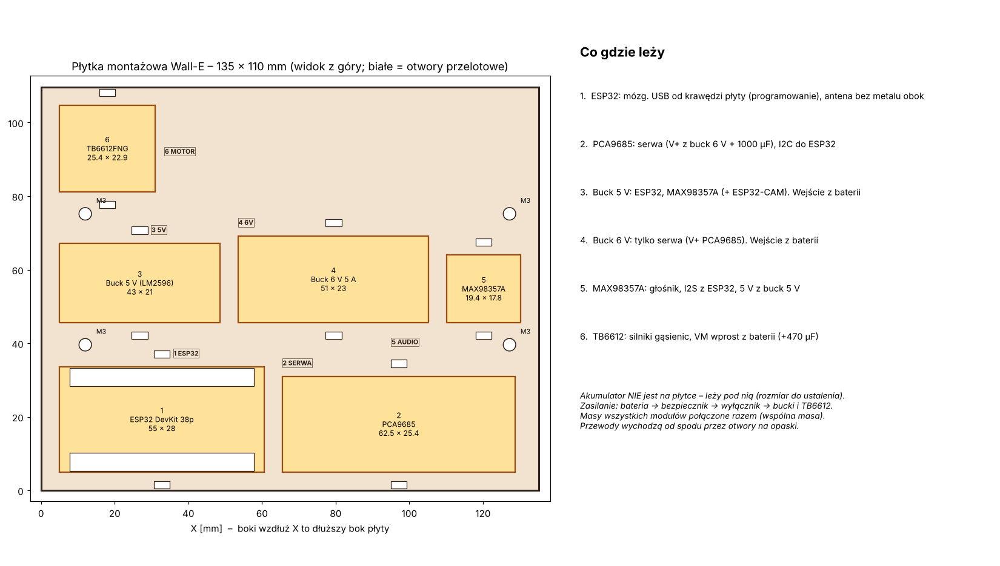

# Płytka montażowa elektroniki (druk 3D)

Status: **projekt nieprzetestowany** – siatki STL są poprawne geometrycznie (zamknięte, wygenerowane skryptem), ale płytka **nie była drukowana** ani przymierzana do prawdziwych modułów. Najpierw wydrukuj szablon (pkt 3).

**Wersja 2 (przeliczona pod model 3MF z Printables):** płyta ma 135 × 110 mm (była 157 × 84), mieści się we wnętrzu korpusu, niesie **samą elektronikę** (w tym TB6612FNG), a **akumulator leży osobno pod nią**. Wymiary wnętrza pochodzą z rozłożonych części 3MF – pkt 4.

Pliki: [`hardware/mounting-plate/`](../hardware/mounting-plate/) – `plate.py` (generator, jedyne źródło wymiarów), `walle_plate.stl`, `walle_fit_coupon.stl`, `walle_spacer.stl`, `preview.png`.

## 1. Koncepcja

Sprawdzone wzorce z internetu (płytki pod ESP32 na Printables/MakerWorld, porady o wkrętach i wkładkach gwintowanych) sprowadzają się do trzech rozwiązań: gwint w słupku, wkładka gwintowana albo wsuwana kieszeń. **Wybrałem kieszenie + opaski zaciskowe**, bo kilka z naszych modułów nie ma otworów montażowych (MAX98357A) lub mają je w nieznanych miejscach (klony PCA9685), a wymiary klonów się różnią.

- Każdy moduł leży w kieszeni wyznaczonej czterema narożnymi kątownikami (luz 0,3 mm na stronę) – bez śrub.
- Moduły są unieruchamiane opaską zaciskową 2,5–3,6 mm przez dwa otwory przy kieszeni (prowadzona w poprzek krótszego boku).
- Pod narożnikami płytek (poza ESP32) są półki 2,5 mm, żeby lutowania od spodu nie opierały się o płytę.
- **ESP32** ma kołki zlutowane w dół: pod obydwoma rzędami pinów jest szczelina przelotowa (obejmuje rozstaw 22,86 i 25,4 mm). Dlatego płyta stoi na odstępnikach.
- Cztery otwory M3 w pasach między rzędami modułów (nie w narożnikach – tam stoją kieszenie); odstępniki ≥ 12 mm (kupne M3 żeńsko-żeńskie albo `walle_spacer.stl`, 4 szt.).
- Bez podpór: wszystkie ścianki pionowe, płyta płasko na stole. Płyta ma 135,2 × 109,7 mm i 3,5 mm grubości (do 10,5 mm z kątownikami).

Rozmieszczenie (3 rzędy, `ROWS` w `plate.py`): dół – ESP32, PCA9685; środek – buck 5 V, buck 6 V, MAX98357A; góra – TB6612FNG (obok niego wolne miejsce na bezpiecznik/wyłącznik/kondensatory).

**Akumulator pod płytą:** rozmiar jeszcze nieznany, więc płyta go nie obejmuje. Leży na dnie korpusu, a płyta stoi nad nim na odstępnikach. **Wysokość odstępnika = wysokość akumulatora + ok. 3 mm** (min. 12 mm ze względu na piny ESP32). Gdy zdecydujesz o baterii, wygeneruj odstępniki: `python3 hardware/mounting-plate/plate.py <wysokość_mm>` (np. `35`) albo kup odstępniki M3 żeńsko-żeńskie. Szerokość/głębokość akumulatora ogranicza tylko wnętrze korpusu (ok. 142 mm szer.), nie płyta.

**Poza płytką:** ESP32-CAM (osobny moduł w głowie/korpusie, ma tylko zasilanie i masę). Bezpiecznik, wyłącznik i kondensatory nie mają kieszeni – lutuj je w przewodzie przy modułach.

## 1a. Co gdzie leży

Numery jak na [podglądzie](../hardware/mounting-plate/preview.png). Współrzędne: lewy dolny róg kieszeni, od lewego dolnego rogu płyty, widok z góry [mm]. Piny i zasilanie – wg [`electronics.md`](electronics.md).

| Nr | Element | Pozycja na płycie | Rząd | Co podłączyć / uwagi |
|---|---|---|---|---|
| 1 | ESP32 DevKit | x 5, y 5 – lewy dolny róg | 1 (dół) | USB skieruj ku krawędzi płyty, żeby dało się podpiąć kabel; antena bez metalu i przewodów zasilania obok. Piny w dół przez szczeliny |
| 2 | PCA9685 | x 66, y 5 – prawy dolny | 1 | I2C z ESP32; V+ serw z buck 6 V (+1000 µF przy złączu) |
| 3 | Buck 5 V | x 5, y 46 – lewy środek | 2 | Zasila ESP32 i MAX98357A (oraz ESP32-CAM poza płytą) |
| 4 | Buck 6 V 5 A | x 54, y 46 – środek | 2 | Tylko serwa; blisko PCA9685 (krótkie grube przewody) |
| 5 | MAX98357A | x 110, y 46 – prawy środek | 2 | Głośnik, I2S z ESP32 |
| 6 | TB6612FNG | x 5, y 81 – lewa góra | 3 (góra) | Silniki gąsienic; VM wprost z baterii (+470 µF). Obok wolne miejsce na bezpiecznik 5 A, wyłącznik i kondensatory |
| – | Akumulator 2S | **pod płytą**, na dnie korpusu | – | Rozmiar do ustalenia; bezpiecznik 5 A i wyłącznik w przewodzie „+” |

Zasada układu: ciężki akumulator nisko, pod płytą; bucki w środku między baterią a odbiornikami, ESP32 i PCA9685 na dole z dala od zakłóceń silników. Pozycje podają wartości z `layout()` (wylicza je skrypt); jeśli zmienisz wymiary modułów, tabela się przesunie – odtwórz podgląd i popraw ją. Który bok płyty jest przodem robota, **jeszcze nie ustalono** (zależy od przymiarki w korpusie).

### Napisy na płytce

W `walle_plate.stl` są **wyryte** (0,8 mm, litery 3,5 mm, czcionka pogrubiona) krótkie napisy obok każdej kieszeni, numerowane jak w tabeli: `1 ESP32`, `2 SERWA`, `3 5V` (buck 5 V), `4 6V` (buck 6 V), `5 AUDIO` (MAX98357A), `6 MOTOR` (TB6612). Napis stoi nad lub pod swoją kieszenią, a `6 MOTOR` z jej prawej strony. Położenie wybiera skrypt automatycznie (omija otwory na opaski, otwory M3 i kątowniki) i przerywa z błędem, gdy nie ma miejsca. Treść napisów – słownik `LABELS` w `plate.py`. **Nie sprawdzone w druku:** 0,8 mm głębokości i 3,5 mm liter powinno być czytelne przy dyszy 0,4 mm, ale nie wydrukowałem tego. Przy płycie drukowanej do góry dnem (brim) napisy są na wierzchu – drukuj ją licem do góry.

## 2. Wymiary i piny – co sprawdzono

Strony producentów (Adafruit, SparkFun, Espressif) były w tej sesji **niedostępne** (host poza dozwoloną siecią), więc wymiary pochodzą z wyników wyszukiwania i ofert sklepów. Rysunków mechanicznych nie widziałem.

| Moduł | Przyjęty PCB [mm] | Pewność | Uwagi i źródła |
|---|---|---|---|
| ESP32 DevKit 38 pin | 55 × 28 | średnia | Oferty podają 51–55 × 25–28. Rozstaw rzędów pinów: 25,4 (oryginalny DevKitC V4) lub 22,86 (większość klonów) – [wątek esp32.com](https://esp32.com/viewtopic.php?p=89735), [espboards.dev](https://www.espboards.dev/esp32/esp32-38pin-devkit-generic/), [Cirkit Designer](https://docs.cirkitdesigner.com/component/9d3cdee3-1229-4034-848b-eed5092b800f/esp32-38-pin) |
| PCA9685 | 62,5 × 25,4 | niska–średnia | Jedna oferta: [iFuturetech](https://ifuturetech.org/?p=512) (4 otwory ok. 2,5 mm); inna 60 × 25: [Sigmanortec](https://sigmanortec.ro/en/pca9685-module-i2c-interface-16-ch-servo-motor); 4 otwory ⌀3 mm wg [Tinytronics](https://www.tinytronics.nl/en/mechanics-and-actuators/motor-controllers-and-drivers/servomotor-controllers/16-channel-i2c-pwm-servo-controller-pca9685) (pozycji brak) |
| MAX98357A | 19,4 × 17,8 | średnia | [Adafruit 3006](https://www.adafruit.com/products/3006); klony mogą się różnić |
| Buck 5 V 3 A | 43 × 21 | ⚠️ założenie | Typowy LM2596 – **nie sprawdzano** |
| Buck 6 V 5 A | 51 × 23 | ⚠️ założenie | Typowy XL4015 – **nie sprawdzano** |
| TB6612FNG | 25,4 × 22,9 | niska–średnia | Górna granica z klonów (24 × 21 – 25,4 × 22,9) |
| Akumulator 2S | – | nieznany | Poza płytą (leży pod nią) – patrz pkt 1 |

Nie zmieniałem pinów ani kanałów serw – piny pozostają wg [`electronics.md`](electronics.md). Płyta nie narzuca kolejności pinów; kable idą od spodu i górą przez otwory na opaski.

Nie ujęto: bezpiecznika, wyłącznika i kondensatorów (1000 µF, 470 µF – lutować przy złączach modułów).

## 3. Jak sprawdzić przed drukiem

1. Zmierz suwmiarką wszystkie posiadane moduły (długość, szerokość, rozstaw rzędów pinów ESP32, wysokość kołków) i popraw wartości w słowniku `MODULES` w `plate.py`.
2. Wydrukuj `walle_fit_coupon.stl` (ok. 6 cm³, kilkanaście minut): same obrysy kieszeni z kątownikami. Przyłóż moduły – mają wchodzić z lekkim oporem; jeśli luźno lub ciasno, zmień `CLEAR`.
3. Dopiero potem drukuj `walle_plate.stl`: PETG, warstwa 0,2 mm, 4 ścianki, brim (duża płaska płyta lubi się wyginać – **nie testowane**).
4. Odtworzenie plików po zmianach: `pip install trimesh manifold3d numpy matplotlib scipy networkx && python3 hardware/mounting-plate/plate.py`.

## 4. Wnętrze korpusu – co wiadomo z modelu 3MF

Plik `RECOMENDED_WALL-E_Full_Pieces.3mf` (Printables, autor Kat; korpus skalowany ok. 41 % filmowego) zawiera **części rozłożone na stołach druku, nie złożony model**. Zmierzyłem z niego (siatki, nie rysunki):

| Część | Wymiar [mm] | Wniosek |
|---|---|---|
| `body-bottom` | 156 × 161,3 × 5 | obrys dna; dno ma od spodu zagłębienie 136 × 123,6 |
| `body-front`, `body-back` | 141,9 szer. × 143 wys. | wchodzą między ściany boczne → **wnętrze ok. 142 mm szer.** |
| `body-left/right` | 162,7 × 143, płyta ok. 6–8 mm | wysokość korpusu ok. 143 mm |
| `body-front-door` | 120,5 × 84,4 | klapa/okno w froncie – tędy nie włożysz płyty 135 mm, montuj przed zamknięciem korpusu |

Limity w `plate.py` (`INNER_W_MAX = 142`, `FIT_CLEAR_W = 3`, `INNER_D_MAX = 123,6`) wymuszają, żeby płyta się mieściła: skrypt zgłasza błąd, jeśli zmiana wymiarów modułów ją powiększy.

**Niezweryfikowane (zrób przymiarkę na wydrukowanych częściach korpusu):**
- Głębokość wnętrza przyjęto ostrożnie jako 123,6 mm (zagłębienie na spodzie dna); faktyczna jest prawdopodobnie większa, ale grubości ścian przedniej/tylnej nie wyznaczyłem.
- **Wysokość i kolizje**: nie sprawdzono zestawu z serwami szyi/ramion, silnikami ani żebrami w ścianach bocznych. Stos: odstępnik (≥ 12, w praktyce wysokość akumulatora + 3) + płyta 3,5 + kątowniki ≈ 7 + moduły, plus wysokość modułów (kondensatory bucków, ESP32 ok. 15–20 mm).
- **Sposób mocowania**: dno ma własne otwory (m.in. 4 × ⌀3 w rozstawie 100 × 58 mm, 4 × ⌀3 w rozstawie 40 × 17 mm), ale **nie wiem, do czego służą** (silniki? zaczepy?), więc otwory M3 płyty nie są z nimi zgrane. Płytę możesz przykręcić przez odstępniki do wywierconych otworów, przykleić do dna na gorący klej lub zgrać otwory po przymiarce – pozycje to `HOLE_X` i `ROW_GAP` w `plate.py`.
- Dopasowanie do korpusu to tylko porównanie wymiarów, nie symulacja złożenia.
